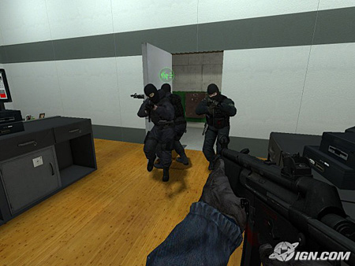

# tactical-intervention-rainbow-six-1998
## Tactical Intervention - Rainbow Six 1998
A total conversion mod for Tactical Intervention that remakes the 1998 game Rainbow Six, recreating its missions, environments, weapons, vehicles, and combat experience in the Tactical Intervention source engine.

## Github Treeview
[https://treegit.macosxjs.com/?url=igiteam/tactical-intervention-rainbow-six-1998](https://treegit.macosxjs.com/?url=igiteam/tactical-intervention-rainbow-six-1998)

## Github Tree Api Direct JSON
[https://api.github.com/repos/igiteam/tactical-intervention-rainbow-six-1998/git/trees/main?recursive=1](https://api.github.com/repos/igiteam/tactical-intervention-rainbow-six-1998/git/trees/main?recursive=1)

## Base gameplay

## WS11WineCX20.0.4 (MacOSX Big Sur 32bit)
[WS11WineCX20.0.4.tar.7z](https://github.com/vitor251093/porting-kit-engines/releases/download/wineskin/WS11WineCX20.0.4.tar.7z)

## Reference links
[https://www.betaarchive.com/forum/viewtopic.php?t=21508](https://www.betaarchive.com/forum/viewtopic.php?t=21508)

# Documentation Images

  

# Tactical Intervention Revived
A maintained non-Steam version of Tactical Intervention. Comes with restored features such as a loadout editor, game installer, server browser and various fixes to restore original game functionality. Plus, some new features such as a mod manager!

**Tactical Intervention Revived only supports Windows (currently)**

    
    &nbsp; &nbsp; &nbsp; &nbsp;
    

    
    

## Discord
Join the [Discord](https://discord.gg/DZhySxaVbr) to chat with other players and share mods.

## How to install
Tactical Intervention Revived will install the whole game as part of the setup process. No previous installs of Tactical Intervention are required.

1. Download the [latest version of Tactical Intervention Revived](https://github.com/vingard/tactical-intervention-rainbow-six-1998-Revived/releases/latest) (Under 'Assets' select `tactical-intervention-rainbow-six-1998-Revived-Setup-X.X.X.exe` with the `X` being the version numbers)
2. Run the launcher installer you just downloaded
3. Open the launcher, follow the automated steps to download and install the game files
4. That's it, simple!

## Legal
Tactical Intervention Revived is a fan project to restore the abadonware game Tactical Intervention.

Tactical Intervention was a free-to-play game released on Steam, developed by Fix Korea Games. Fix Korea Games no longer exists and Tactical Intervention Revived is considered abandonware. The intent of this project is simply to maintain the old state of the game in the best state possible. 

If the IP owner of Tactical Intervention wishes, Tactical Intervention Revived will be removed immediatley.

## Why does it need administrator permissions?
To enable Tactical Intervention Revived's awesome mod support, all the game content files are linked to the game directory virtually with symlinks. To create symlinks on Windows, administrator permissions are required. These symlinks create a 'portal' to files in other locations, tricking the source engine to load the virtual file system that Tactical Intervention Revived creates.

## Hosting a server
See the [Hosting a Server](https://github.com/vingard/tactical-intervention-rainbow-six-1998-Revived/wiki/Hosting-a-Server) page on the Wiki.

## Wiki (modding guidance)
Find further documentation (including mod creation guides) in the [Tactical Intervention Revived Wiki](https://github.com/vingard/tactical-intervention-rainbow-six-1998-Revived/wiki).

## Contributions
Tactical Intervention Revived is an open-source project. All contributions are welcome, just fork the repo and make a PR.

## Dev Environment

**Official White Wii Remote With Nunchuk — Tested And Working — £14.99**
[https://www.ebay.co.uk/itm/800847189353](https://www.ebay.co.uk/itm/800847189353)

**Infrared Sensor Bar USB for Wii Emulator Remote Motion Detection Setup — £6.69**
[https://www.ebay.co.uk/itm/227423830875](https://www.ebay.co.uk/itm/227423830875)

**Apple MacBook Pro Retina 15in (2014) i7 2.8GHz 16GB 1TB SSD GT 750M — £120.30**
[https://www.ebay.co.uk/itm/800844561513](https://www.ebay.co.uk/itm/800844561513)

**WS11WineCX20.0.4 (Wine engine)**
[https://igiteam.github.io/wine_engines/](https://igiteam.github.io/wine_engines/)

**Official Genuine Sony PS3 PlayStation 3 DualShock 3 Wireless Controller Black — £19.99**
[https://www.ebay.co.uk/itm/840031043465](https://www.ebay.co.uk/itm/840031043465)

**Amazon Basics 4K HDMI Cable 3m — 18Gbps High Speed with Ethernet, 4K@60Hz, 2160p — £8.44**
[https://www.ebay.co.uk/itm/327352257557](https://www.ebay.co.uk/itm/327352257557)

**wiimote_nunchuk_macosx**
[https://github.com/igiteam/wiimote-nunchuk](https://github.com/igiteam/wiimote-nunchuk)

**xbox360_input_gui_py**
[https://github.com/igiteam/xbox360_input_gui_py](https://github.com/igiteam/xbox360_input_gui_py)

**logitec_mx_mouse_3_macos**
[https://github.com/igiteam/logitec_mx_mouse_3_macos](https://github.com/igiteam/logitec_mx_mouse_3_macos)

**igi1-macbook-3d-workstation**
[https://github.com/igiteam/igi1-macbook-3d-workstation](https://github.com/igiteam/igi1-macbook-3d-workstation)

---

If you are a rights holder and believe something here should not be distributed,
please open an issue or contact the maintainer and it will be addressed
promptly.

